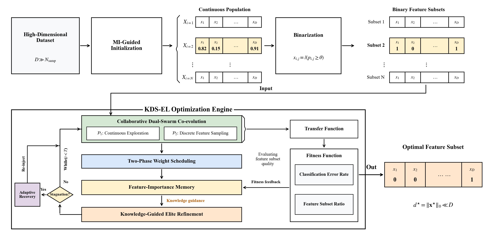

# KDS-EL

**Knowledge-Driven Dual-Swarm Optimization with Elite Learning for High-Dimensional Feature Selection**

## Contents

- [Overview](#overview)
- [Framework](#framework)
- [Dependencies](#dependencies)
- [Instructions](#instructions)
- [Results](#results)

## Overview

KDS-EL is a dual-swarm particle swarm optimization method for high-dimensional feature selection. It uses mutual information (MI) to guide part of the initial population, knowledge-guided elite refinement (KER) to perturb elite solutions, and two-phase parameter scheduling (TPS) to adjust the weights of classification error and feature count during the search.

## Framework



The search uses two subpopulations, feature-credit information accumulated during evolution, elite refinement, and a two-phase scalarized objective. The implementation is provided in `KDS_EL.py`; `utils.py` contains data loading, MI estimation, and elite perturbation functions, and `config.py` contains dataset-loading settings.

## Dependencies

Python 3.10 or later and the dependencies listed in `requirements.txt` are required. Install them with:

```bash
pip install -r requirements.txt
```

## Instructions

- `KDS_EL.py` contains the main KDS-EL algorithm.
- Load a dataset using `load_dataset` in `utils.py`. Adjust the dataset name and paths to match your local files:

  ```python
  from utils import load_dataset

  X, y = load_dataset("Colon", "Datasets/Datasets_part1", "Datasets/Datasets_part2")
  ```

- Configure the algorithm using a parameter dictionary. For example:

  ```python
  opts = {
      "N": 20,                  # population size
      "T": 100,                 # maximum iterations
      "k": 3,                   # KNN neighbors
      "thres": 0.6,             # binarization threshold
      "cv_splits": 5,
      "cv_shuffle": True,
      "cv_random_state": 42,
      "ws_phase1": [0.70, 0.30],
      "ws_phase2": [0.95, 0.05],
  }
  ```

- Set `numpy.random.seed(seed)` before each run to control the optimizer's NumPy random sequence. `OPTIMIZER_SEEDS` in `config.py` records the seeds used in the revised nested experiments; the algorithm does not apply them automatically. `cv_splits.zip` contains the partitions for those nested experiments, which are not run automatically by this implementation. The example above uses five-fold cross-validation with `cv_random_state = 42`.

## Results

We evaluate the method using classification accuracy, feature subset size, and running time. In the reported analysis across 19 datasets, KDS-EL achieved a mean internal cross-validation accuracy of 95.21% and selected 88.9 features on average. Its mean observed running time was 52.5 seconds under the reported experimental environment. These internal-wrapper results describe the evaluated datasets and protocol; they are not independent test-set estimates of generalization.

The algorithm returns the selected feature mask, feature count, scalarized fitness, and fitness curve. The scalarized fitness is not classification accuracy; accuracy must be evaluated separately.
